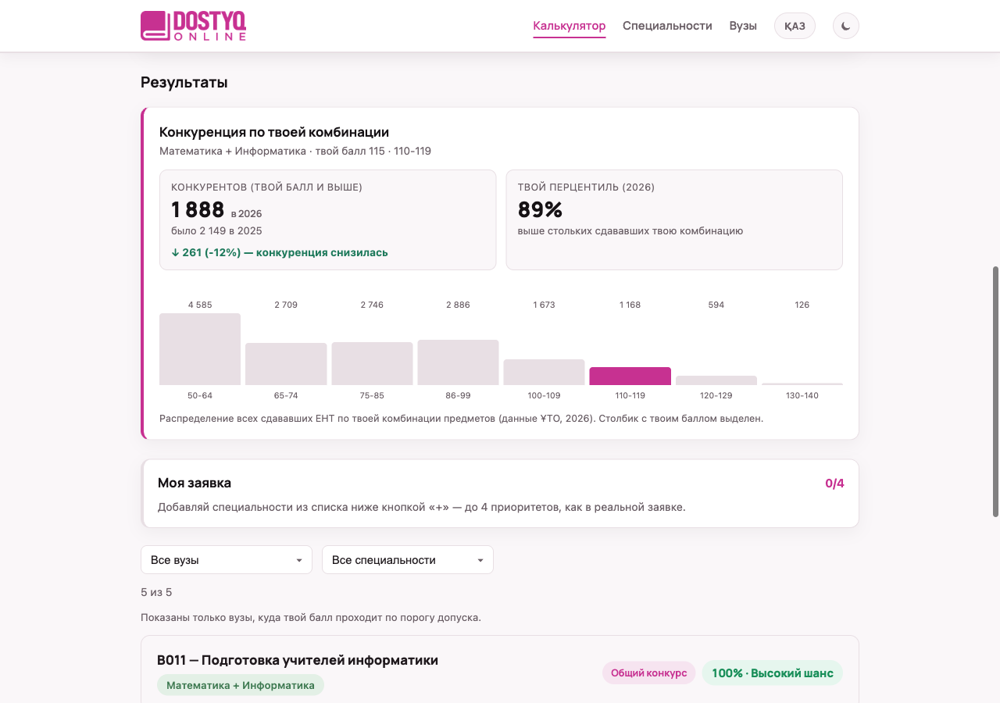
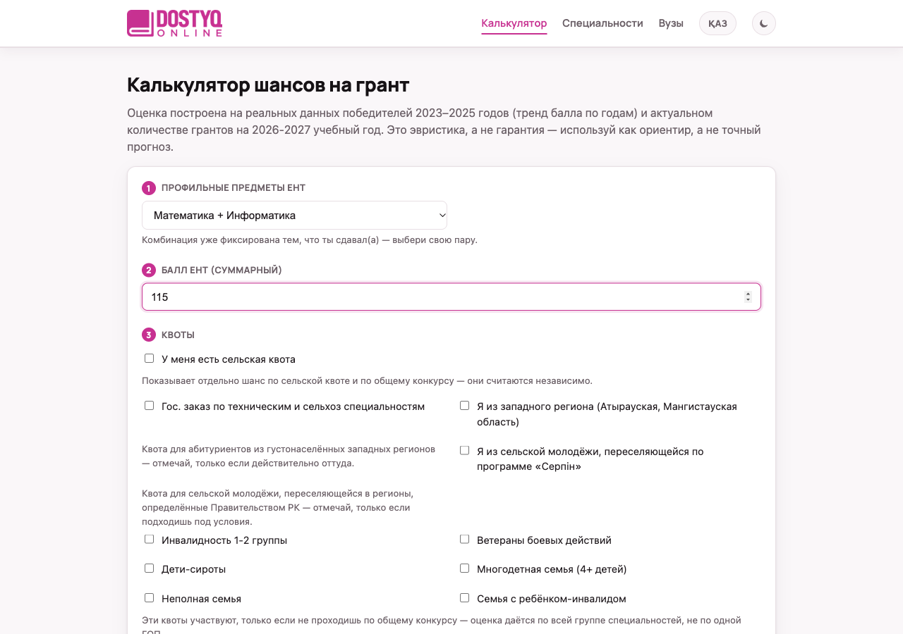
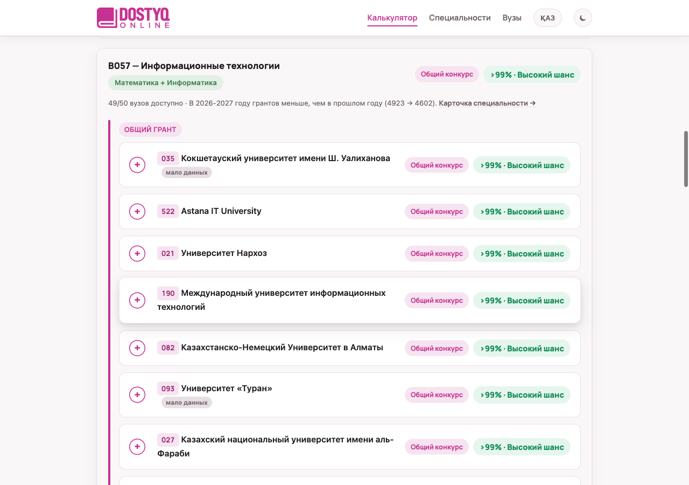
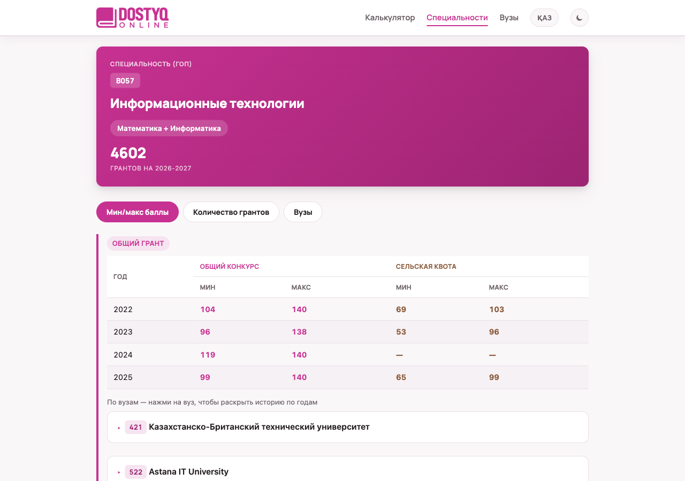
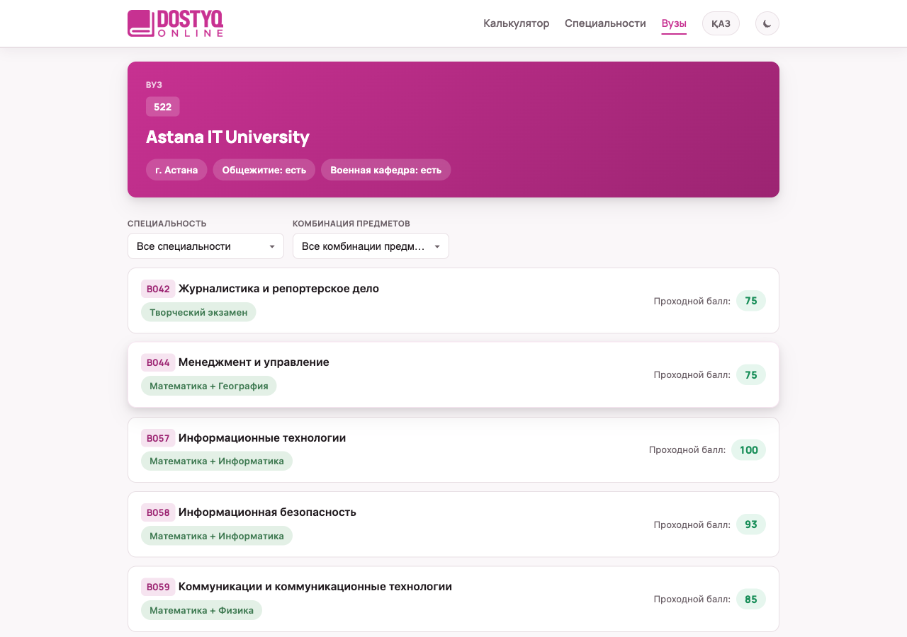
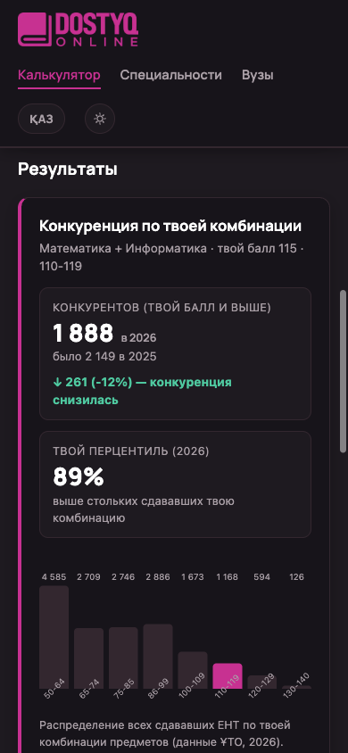

<a href="https://snusik11.github.io/dostyq-grant-calculator/">
    
</a>

# Калькулятор шансов на грант

[](https://snusik11.github.io/dostyq-grant-calculator/)
[](https://snusik11.github.io/dostyq-grant-calculator/)


:star: Поставь звезду на GitHub, нам это очень помогает!

**Калькулятор шансов на грант** от [DOSTYQ ONLINE](https://snusik11.github.io/dostyq-grant-calculator/) показывает абитуриенту Казахстана, насколько реально получить государственный образовательный грант в 2026–2027 учебном году. Введи комбинацию профильных предметов и балл ЕНТ, отметь свои квоты и получи шанс в процентах по каждой специальности и каждому вузу.

Это статический сайт: без сервера, без базы данных и без сборки. Все данные лежат рядом в JSON, поэтому он работает на обычном GitHub Pages.

> Оценка — эвристика, а не гарантия поступления. Используй её как ориентир.

[](https://snusik11.github.io/dostyq-grant-calculator/)

## Оглавление

- [Возможности](#возможности)
- [Скриншоты](#скриншоты)
- [Быстрый старт](#быстрый-старт)
- [Структура проекта](#структура-проекта)
- [Как считается шанс](#как-считается-шанс)
    - [Ограничения модели](#ограничения-модели)
- [Источники данных](#источники-данных)
- [Обновление данных](#обновление-данных)
- [Деплой](#деплой)

## Возможности

| Раздел | Маршрут | Что внутри |
|---|---|---|
| Калькулятор | `#/` | Комбинация предметов, балл ЕНТ и квоты → список специальностей и вузов с шансом в процентах |
| Специальности | `#/specialties`, `#/specialties/{код}` | Каталог ГОП, карточка с мин/макс баллами по годам, числом грантов и вузами |
| Вузы | `#/universities`, `#/universities/{код}` | Каталог вузов (регион, общежитие, военная кафедра), карточка вуза со всеми специальностями и проходными баллами |

Что умеет калькулятор:

- **Шанс в процентах** для каждой пары «специальность × вуз» с ярлыком: высокий (≥ 70%), средний (≥ 35%), низкий.
- **Фильтр по порогу допуска.** Вуз показывается, только если балл не ниже порога допуска к конкурсу 2026.
- **Квоты:** общий конкурс, сельская квота, педагогическая, техническая и сельскохозяйственная, западный регион, «Серпін». Групповые квоты (сироты, многодетные, инвалидность и другие) оцениваются по группе специальностей, а не по одному вузу.
- **Панель конкуренции.** Сколько сдающих по твоей комбинации набрали твой балл и выше, как это изменилось с 2025 года и какой у тебя перцентиль (данные ҰТО).
- **«Моя заявка».** Список до 4 приоритетов, как в реальной заявке. Хранится в браузере.
- **Два языка:** русский и казахский.
- **Светлая и тёмная темы**, адаптивная вёрстка вплоть до 375 px.

## Скриншоты

### Ввод данных

[](docs/screenshots/01-calculator.png)

Три шага: профильные предметы, суммарный балл ЕНТ, квоты.

### Результаты

[](docs/screenshots/03-specialty-cards.png)

Каждая специальность раскрывается в список вузов с шансом, пометкой квоты и значком «мало данных», если победителей в прошлом году было мало.

### Карточка специальности и карточка вуза

| Специальность | Вуз |
|---|---|
| [](docs/screenshots/04-specialty.png) | [](docs/screenshots/05-university.png) |
| Мин/макс баллы по годам, число грантов, список вузов | Регион, общежитие, военная кафедра, проходные баллы по специальностям |

### Мобильная версия и тёмная тема

<p align="center">
  
</p>

## Быстрый старт

Нужен любой статический сервер. Открывать `index.html` двойным кликом нельзя: браузер заблокирует загрузку `data/*.json` через `file://`.

```bash
git clone https://github.com/Snusik11/dostyq-grant-calculator.git
cd dostyq-grant-calculator
python3 -m http.server 8000
```

После этого открой http://localhost:8000.

## Структура проекта

Без фреймворков и без бэкенда: чистые HTML, CSS и JavaScript. Роутинг построен на хэше (`#/...`), поэтому ничего не нужно настраивать на сервере.

```
.
├── index.html              # точка входа, шапка, подключение скриптов
├── app.js                  # роутер, рендер страниц, i18n (RU/KK), «Моя заявка»
├── styles.css              # стили, темы, адаптив
├── assets/
│   └── logo.webp
├── docs/
│   └── screenshots/        # картинки для README
└── data/                   # готовый датасет (генерируется, руками не правится)
    ├── specialties.json              # ГОП: названия RU/KK, комбинации предметов, число грантов
    ├── universities.json             # вузы: регион, общежитие, воен. кафедра, пороги допуска
    ├── paths.json                    # специальность × вуз: общий конкурс и сельская квота
    ├── order_quota_paths.json        # пед-, тех-, западная квоты и «Серпін»
    ├── group_paths.json              # групповые квоты (сироты, многодетные и т. д.)
    ├── ped_quota_info.json           # справка по педагогической квоте
    ├── rural_quota_specialties.json  # специальности, где есть сельская квота
    └── ent_distribution.json         # распределение баллов ЕНТ по комбинациям предметов
```

Состояние в браузере (`localStorage`):

| Ключ | Что хранит |
|---|---|
| `lang` | Язык интерфейса (`ru` / `kk`) |
| `theme` | Тема (`light` / `dark`), по умолчанию светлая |
| `dostyq_application` | Содержимое «Моей заявки» |

## Как считается шанс

Фронтенд формулу не считает. Для каждого пути в `data/*.json` лежит готовый массив `probability_curve`, индекс которого равен баллу ЕНТ (0…140). Сайт берёт значение по индексу.

Кривую строит Python-сборщик датасета по такой схеме:

```
 история баллов победителей 2023–2025
            │
            ▼
   проходной балл за год (минимум победителя)
            │
            ▼
   тренд по годам (нужно ≥ 3 года, иначе тренд = 0)
            │
            ├── поправка на изменение числа грантов 2025 → 2026
            ├── поправка на давление сильных абитуриентов комбинации
            ▼
   прогнозный проходной балл на 2026
            │
            ▼
   p = 1 / (1 + exp(−k · (твой_балл − прогноз)))
            │
            ▼
   выравнивание: шанс не растёт с ростом порога допуска внутри специальности
```

- При балле ровно на прогнозном пороге шанс около 50%.
- Крутизна `k` растёт с плотностью победителей у порога и падает с волатильностью истории.
- Для сельской квоты прогноз не может быть выше общего конкурса.
- Если победителей в последнем году меньше 5, у пути стоит пометка «мало данных».

### Ограничения модели

- Якорь модели — **минимальный** балл победителя за год. Один победитель с низким баллом (например, льготник) может занизить прогноз.
- Порог допуска (фильтр вузов) и история победителей (вероятность) берутся из разных источников и между собой не сверяются.
- Для медицинских вузов (госзаказ Минздрава) нет истории победителей, есть только пороги.
- Пары «специальность × вуз», которые вуз по актуальным данным больше не набирает, исключены из выдачи.

## Источники данных

| Источник | Что даёт |
|---|---|
| Списки обладателей гранта 2023, 2024, 2025 (PDF) | Баллы победителей — основа истории и вероятности |
| Пороговые баллы вузов 2026 (xlsx) | Порог допуска к конкурсу, по нему фильтруются вузы |
| Число грантов 2024–2025 и 2026–2027 (xls/docx) | Число мест, поправка на изменение конкурса |
| Соответствие комбинаций профильных предметов (xlsx, 2024) | Пары предметов для специальностей, названия RU/KK |
| Распределение баллов ЕНТ по комбинациям (ҰТО, 2025–2026) | Панель конкуренции |
| testcenter.kz | Квоты: техническая и сельскохозяйственная, «Серпін» |
| eduser.app, edutest.kz | Регионы, общежития, воен. кафедры, казахские названия, пед-квота и недостающие годы |

В публичный датасет попадают только агрегаты (проходной, минимум, максимум, медиана, число победителей). ФИО и ИКТ победителей наружу не выходят, сборщик проверяет это перед выгрузкой.

## Обновление данных

Сборщик датасета (Python) в этот репозиторий не входит. Он читает исходные PDF, xls и xlsx, склеивает их, считает кривые вероятности и записывает 8 JSON-файлов, которые копируются в `data/`.

Для его запуска нужны Python 3 и пакеты:

```bash
pip install pymupdf pandas lxml openpyxl python-docx rapidfuzz requests selenium
python3 build_dataset.py
```

Скрейперы (testcenter.kz, eduser.app, edutest.kz) работают через Selenium, поэтому нужен Chrome.

После пересборки новые файлы кладутся в `data/` и коммитятся вместе с кодом сайта.

## Деплой

Сайт публикуется через GitHub Pages из ветки `main`, корень репозитория. Пуш в `main` запускает пересборку.
